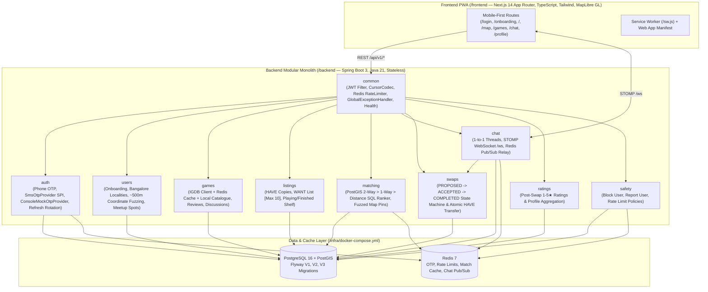

# GameSwap Bangalore — Phase 1 (MVP)

**GameSwap** is a hyperlocal Progressive Web App (PWA) where console gamers in **Bangalore** list physical games they **HAVE** and **WANT**, get matched with nearby gamers via **PostGIS**, explore fuzzed (~500m) neighbourhood pins on an interactive **MapLibre GL** map, chat in real time over **STOMP WebSockets + Redis Pub/Sub**, pick public Bangalore meetup spots (malls, gaming cafes, metro stations), and complete verified in-person swaps.

---

## Architecture & Module Diagram

GameSwap is designed as a **12-factor, stateless modular monolith** in **Spring Boot 3 (Java 21)** with strict domain package boundaries so it can scale from MVP to **1,000,000+ users** (see [`docs/SCALING_NOTES.md`](docs/SCALING_NOTES.md)).



---

## Quick Start

### Option A: Docker Compose (Full Stack in 1 Command)

```bash
cd infra
cp .env.example .env
docker compose up --build
```

- **Frontend PWA:** `http://localhost:3000`
- **Backend API:** `http://localhost:8080/api/v1`
- **Health Check:** `http://localhost:8080/api/v1/health`
- **OpenAPI 3 Spec / Swagger UI:** `http://localhost:8080/v3/api-docs` & `http://localhost:8080/swagger-ui.html`

### Option B: Local Development (Backend + Frontend)

1. **Start PostgreSQL (with PostGIS) & Redis** (via Docker or local installation):
   ```bash
   docker compose -f infra/docker-compose.yml up -d postgres redis
   ```
2. **Run Backend (Spring Boot 3 / Java 21):**
   ```bash
   cd backend
   ./gradlew bootRun
   ```
   Flyway automatically executes:
   - `V1__init_schema.sql`: Core tables, UUID primary keys, GiST spatial indexes, and composite B-Tree indexes.
   - `V2__seed_bangalore_reference_data.sql`: 20 Bangalore localities (area centroids) and 16 public meetup spots (malls, gaming cafes, metro stations, bookstores).
   - `V3__seed_demo_data.sql`: **20 popular console games** and **50 fake gamers across 5 Bangalore hubs** (Indiranagar, Koramangala, HSR Layout, Whitefield, Jayanagar) with pre-populated `HAVE`/`WANT` lists, reviews, discussions, and a live swap proposal.
3. **Run Frontend (Next.js App Router PWA):**
   ```bash
   cd frontend
   npm install
   npm run dev
   ```
   Open `http://localhost:3000`.

---

## Instant Demo Accounts (Pre-Seeded in `V3__seed_demo_data.sql`)

You can sign in with **1 click** on the `/login` screen or enter any of the 50 seeded Indian mobile numbers (`+91 9876543210` through `+91 9876543259`). In development mode (`OTP_PROVIDER=mock`), the 6-digit OTP is logged to the backend console and displayed in the dev banner.

| Handle | Phone Number | Locality | Consoles | Highlights |
|---|---|---|---|---|
| `@arjun_blr` | `9876543210` | Indiranagar | PS5, Switch | **HAS:** *Elden Ring*, *God of War Ragnarök*, *Zelda TOTK* <br>**WANTS:** *Spider-Man 2*, *Ghost of Tsushima*, *Astro Bot*, *Mario Wonder* |
| `@kavya_plays` | `9876543211` | Indiranagar | PS5, Switch | **2-Way Match with `@arjun_blr`** (*Spider-Man 2* ↔ *Elden Ring*) + active swap proposal in chat |
| `@nikhil_ps5` | `9876543212` | Indiranagar | PS5, Series X/S | **2-Way Match with `@arjun_blr`** (*Ghost of Tsushima* ↔ *God of War Ragnarök*) |
| `@rohan_kora` | `9876543220` | Koramangala | PS5, PS4 | **2-Way Match ~5.1 km away** (*Astro Bot* ↔ *Elden Ring*) |

---

## Running Tests

### Backend Integration Tests (JUnit 5 + Testcontainers)
Tests cover phone OTP auth, refresh token rotation, OTP rate limiting, onboarding coordinate fuzzing & privacy guarantees, max 10 active wants constraint, PostGIS 2-way vs 1-way match ranking, cursor pagination, user blocking, and the full swap lifecycle (`PROPOSED -> ACCEPTED -> COMPLETED` with automatic `HAVE` list transfer and post-swap ratings):

```bash
cd backend
./gradlew test
```

### Frontend E2E Tests (Playwright)
```bash
cd frontend
npx playwright test
```

---

## Privacy & Security Guarantees

- **Zero Exact Home Locations:** Users only pick a Bangalore locality (`Indiranagar`, `Koramangala`, `HSR Layout`, etc.). Spatial matching uses the locality's centroid (`area_point`), and map pins are deterministically fuzzed by **~350m–550m** (`fuzz_lat`, `fuzz_lng`) so exact addresses are never collected, stored, or exposed.
- **Zero Phone/PII Exposure:** Phone numbers are normalized to E.164, hashed with `HMAC-SHA256` (`phone_hash`) for lookup, encrypted at rest with `AES-256-GCM` (`phone_encrypted`), and never returned in any API payload.
- **Rate Limiting:** Redis-backed rate limits protect OTP generation (5/10 min), chat messages (30/min), and want list mutations (15/min).
- **Instant Block Enforcement:** Blocking a user (`POST /api/v1/safety/blocks/{userId}`) immediately excludes them from PostGIS match results, map pins, game owner lists, profiles, and chat threads, and cancels any pending swap proposals.

